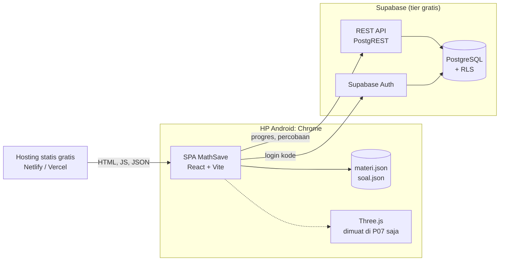
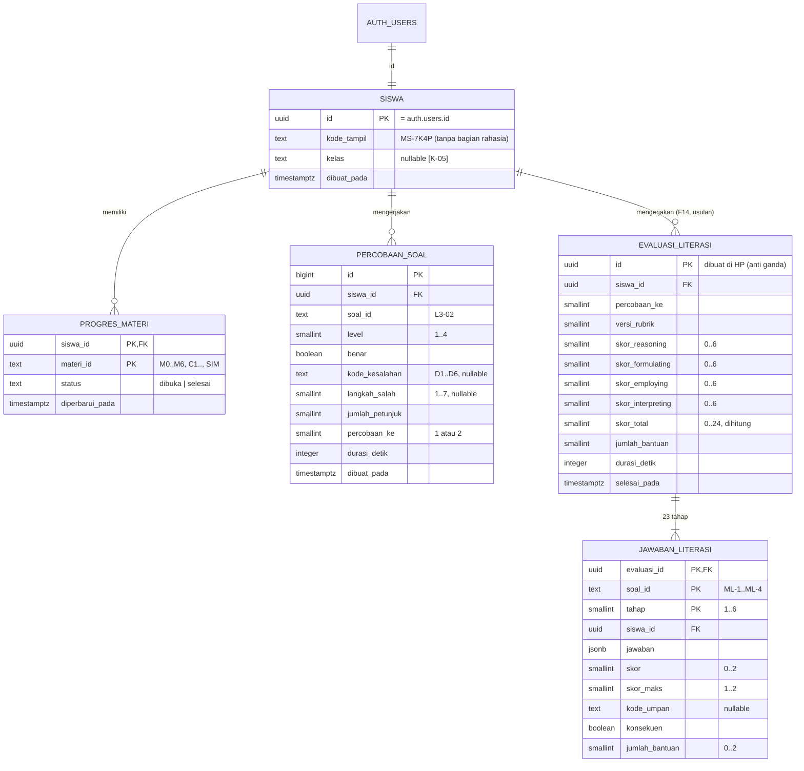
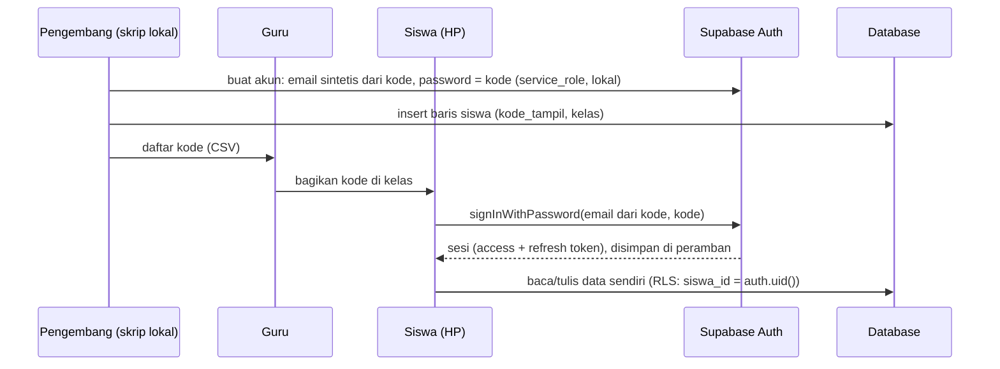
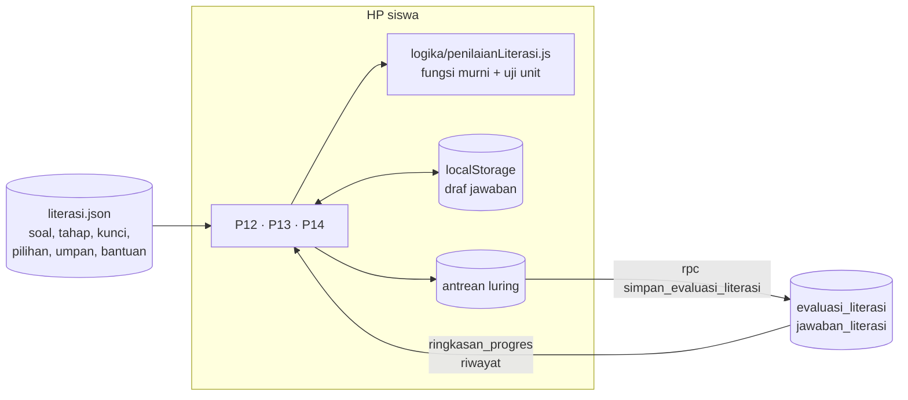

# Architecture — MathSave

Versi: 0.2 · Acuan: [PRD.md](PRD.md) · [api.md](api.md)

Riwayat: 0.1 disetujui 11 November 2026. **0.2 (12 November 2026, menunggu persetujuan):** rancangan teknis F14 Latihan Literasi Matematis (§4, §7, §8, §10).

Butir bertanda **[Keputusan K-xx]** sudah disetujui pada 11 November 2026 (PRD §13). Butir bertanda **[Konfirmasi]** tanpa nomor masih terbuka.

---

## 1. Gambaran Arsitektur

MathSave adalah aplikasi web statis (Single Page Application) yang berbicara langsung dengan Supabase. Tidak ada server backend buatan sendiri.



Pembagian tanggung jawab:

| Bagian | Isi | Alasan |
|---|---|---|
| Frontend (statis) | Antarmuka, konten materi, bank soal, logika rumus, diagnosis kesalahan, fading | Konten jarang berubah; respons cepat tanpa menunggu server; hemat kuota |
| Supabase | Login, data progres, catatan percobaan, hasil Literasi Matematis (F14) | Data per siswa yang perlu disimpan permanen |

## 2. Teknologi Frontend

| Teknologi | Peran | Status |
|---|---|---|
| Vite | Build tool dan server pengembangan | [Keputusan K-01] |
| React (JavaScript) | Komponen antarmuka | [Keputusan K-01]; alternatif: JavaScript tanpa framework |
| React Router | Navigasi antarhalaman | Mengikuti K-01 |
| CSS biasa + custom properties | Gaya dan token warna ([design.md](design.md) §11) | Tanpa framework CSS, agar ringan |
| Three.js | Visualisasi 3D di P07 | [Spesifikasi]; versi dikunci saat development |
| @supabase/supabase-js | Klien Supabase | – |
| Vitest | Uji unit logika rumus dan diagnosis | – |

## 3. Teknologi Backend

Backend menggunakan **Supabase** sebagai *Backend-as-a-Service* (tier gratis): Auth, PostgreSQL, REST API otomatis (PostgREST), dan fungsi SQL (RPC). Tidak ada Edge Function yang wajib di P1.

Hal yang perlu diperhatikan pada tier gratis Supabase (perlu dicek ulang saat pembuatan proyek, karena kebijakan bisa berubah):
- Proyek **dijeda otomatis** jika tidak aktif sekitar satu minggu. Selama masa uji coba, proyek harus dibuka secara berkala atau dipulihkan dari dashboard.
- Batas ukuran database dan jumlah pengguna bulanan cukup untuk skala satu atau dua kelas.

## 4. Database Supabase



Tabel `EVALUASI_LITERASI` dan `JAWABAN_LITERASI` adalah **[Usulan, KL-13]** (12 November 2026) dan belum dibuat.

Konten materi dan soal **tidak** disimpan di database (lihat §1). Detail kolom dan kebijakan RLS ada di [api.md](api.md) §4.

## 5. Alur Autentikasi Kode Siswa

**[Keputusan K-03]** Rekomendasi: **Supabase Auth dengan satu akun per siswa**. Kode siswa berfungsi sebagai identitas sekaligus rahasia.

Format kode: `MS-XXXX-XXXX`. Terdiri dari 8 karakter acak dari 31 huruf/angka yang tidak mirip (tanpa O, 0, I, 1, L). Kode tidak bisa ditebak dan mudah dibaca siswa.



Rincian:
1. Siswa mengetik kode. Frontend menormalkan kode (huruf besar, menghapus spasi dan tanda "-").
2. Email sintetis = `<kode-ternormal>@<domain-sintetis>`, misalnya `ms7k4pq2xr@siswa.mathsave.app`. Email ini tidak pernah dipakai untuk mengirim surat. Konfirmasi email dimatikan, dan akun dibuat dengan `email_confirm: true`. Domain sintetis **[Konfirmasi]**.
3. Sesi disimpan oleh supabase-js dan diperbarui otomatis, sehingga siswa tidak perlu login ulang setiap kali membuka aplikasi (KFN-02).
4. Pembuatan akun dilakukan oleh skrip `supabase/scripts/buat-akun-siswa.js` yang dijalankan di komputer pengembang dengan kunci `service_role`. Kunci ini tidak pernah masuk ke frontend atau repositori **[Keputusan K-04]**.

Alternatif jika K-03 ditolak: fungsi RPC `masuk_dengan_kode` yang mengembalikan token sesi buatan sendiri. Kelemahannya: lebih banyak kode keamanan yang harus ditulis sendiri.

## 6. Integrasi Three.js

- Modul `src/three/AdeganBarang.js` diekspor sebagai fungsi `pasang(elemen, { hb, hj })` dan `perbarui({ hb, hj })`, serta `lepas()` untuk membersihkan memori saat halaman ditutup.
- Halaman P07 memuat modul ini dengan `import()` dinamis, sehingga Three.js tidak ikut dalam unduhan awal.
- Pemeriksaan WebGL dilakukan sebelum memuat. Jika gagal, ditampilkan komponen 2D `BarangDuaDimensi`.
- Render **on-demand**: `renderer.render()` hanya dipanggil saat slider berubah atau saat barang diputar.
- `devicePixelRatio` dibatasi maksimal 2 agar ringan di HP.
- Label harga berupa elemen HTML yang diposisikan di atas kanvas.

## 7. Alur Pertukaran Data

| Peristiwa | Data | Arah | Kapan |
|---|---|---|---|
| Buka aplikasi | `materi.json`, `soal.json` | Hosting → HP | Sekali; disimpan di cache peramban |
| Login | kode → sesi | HP ↔ Auth | Saat masuk |
| Buka Beranda/Progres | `ringkasan_progres()` | DB → HP | Setiap halaman dibuka |
| Selesai submateri | upsert `progres_materi` | HP → DB | Di kartu terakhir |
| Menjawab soal | insert `percobaan_soal` | HP → DB | Setiap jawaban akhir (bukan setiap langkah) |
| Simulasi | – | – | Tidak disimpan; hanya `progres_materi` (SIM) saat dibuka pertama kali |
| F14: menyimpan tahap | draf jawaban | HP saja (`localStorage`) | Setiap "Simpan & lanjut" |
| F14: selesai 4 soal | `rpc/simpan_evaluasi_literasi` | HP → DB | Sekali per percobaan |
| F14: riwayat | `evaluasi_literasi`, `jawaban_literasi` | DB → HP | Saat membuka P11/P14 riwayat |

Jika penyimpanan gagal (koneksi putus), data ditampung di antrean `localStorage` dan dikirim ulang saat online. Siswa tetap bisa melanjutkan belajar.

## 8. Struktur Folder Aplikasi (rencana)

Belum dibuat. Akan dibuat pada tahap Development setelah dokumentasi disetujui.

```text
mathsave/
├── README.md
├── AGENTS.md
├── docs/                         dokumentasi (PRD, design, architecture, api, task)
├── referensi/                    file wawancara [Keputusan K-10]
├── app/
│   ├── index.html
│   ├── package.json
│   ├── vite.config.js
│   ├── .env.example              VITE_SUPABASE_URL, VITE_SUPABASE_ANON_KEY
│   ├── public/
│   │   ├── data/materi.json      M0–M6, contoh bertahap
│   │   ├── data/soal.json        bank soal Level 1–4
│   │   ├── data/literasi.json    F14: 4 soal Literasi Matematis, tahap, rubrik (usulan)
│   │   └── gambar/               gambar barang 2D berlabel harga (SVG)
│   ├── src/
│   │   ├── main.jsx, App.jsx, rute.jsx
│   │   ├── halaman/              Masuk, Beranda, DaftarMateri, KartuMateri, KartuRumus,
│   │   │                         ContohBertahap, Simulasi, PilihLevel, Soal, Progres
│   │   ├── komponen/             LabelHarga, RumusTerisi, TeksBertanda, BilahLangkah,
│   │   │                         InputRupiah, InputPersen, TombolPilihan, TombolPetunjuk,
│   │   │                         LembarBawah, BatangBanding, NavBawah
│   │   ├── three/AdeganBarang.js
│   │   ├── logika/               hitung.js, diagnosis.js, fading.js, format.js,
│   │   │                         penilaianLiterasi.js (F14, usulan)
│   │   ├── layanan/              supabase.js, auth.js, progres.js, antrean.js
│   │   └── gaya/                 token.css, dasar.css
│   └── tests/                    hitung.test.js, diagnosis.test.js, format.test.js
└── supabase/
    ├── migrations/001_skema.sql
    └── scripts/buat-akun-siswa.js
```

## 9. Pertimbangan Keamanan

| Risiko | Penanganan |
|---|---|
| Kunci `service_role` bocor | Hanya dipakai di skrip lokal; `.env` masuk `.gitignore`; frontend hanya memakai `anon key` |
| Siswa membaca data siswa lain | RLS di semua tabel: `siswa_id = auth.uid()` |
| Menebak kode | 8 karakter acak (sekitar 8,5 × 10¹¹ kombinasi) + pembatasan percobaan login bawaan Supabase Auth |
| Data pribadi | Tidak ada nama asli, foto, atau kontak siswa (KNF-07). Identitas informan wawancara tidak dimuat di aplikasi maupun repositori |
| Kunci jawaban terlihat di `soal.json` | Diterima, karena latihan bersifat formatif (bukan nilai rapor). Jika latihan dipakai untuk penilaian resmi, pemeriksaan jawaban harus dipindah ke fungsi server **[Konfirmasi]** |
| Siswa memalsukan data progres | Risiko rendah dan dampak kecil (formatif); validasi tipe dan rentang lewat constraint database |
| XSS dari konten | Konten berasal dari JSON milik sendiri; tidak ada HTML dari pengguna yang dirender |

## 10. Rancangan Teknis F14 Latihan Literasi Matematis dan Evaluasi

Ditambahkan 12 November 2026. Seluruh bagian ini adalah **[Usulan]** dan menunggu persetujuan (PRD §13.1, KL-01 sampai KL-15). Belum ada kode atau perubahan database yang dibuat.

### 10.1 Komponen sistem



| Bagian | Tanggung jawab |
|---|---|
| `public/data/literasi.json` | Konten F14: segmen soal, tahap, kunci, pilihan, kode umpan balik, teks umpan balik, bantuan, saran materi, `urutan`, `versi_rubrik`. Teks soal dan kunci disalin dari PRD §8.4 tanpa perubahan |
| `src/logika/penilaianLiterasi.js` | Menilai satu tahap, satu soal, dan seluruh latihan; menghitung skor per indikator; memilih saran materi. Tanpa React dan tanpa jaringan, sehingga mudah diuji (AGENTS.md §6) |
| `src/halaman/` | `LatihanLiterasi.jsx` (P12), `KerjakanLiterasi.jsx` (P13), `HasilLiterasi.jsx` (P14) |
| `src/layanan/literasi.js` | Menyimpan draf, mengirim hasil (lewat antrean), membaca riwayat |
| Supabase | Menyimpan hasil akhir dan jawaban per tahap; RLS per siswa |

### 10.2 Proses penilaian

Penilaian dilakukan **di HP siswa** dengan fungsi deterministik, sama seperti diagnosis latihan Level 1–4 (§1). Alasannya: umpan balik muncul tanpa menunggu server, tetap bisa dipakai saat koneksi lambat, dan tidak memerlukan Edge Function.

```text
nilaiTahap(soal, tahap, jawaban, jawabanSebelumnya) → { skor, skorMaks, kode, konsekuen }
nilaiSoal(soal, jawabanSemuaTahap)                  → { skor (0–6), tahap: [...] }
nilaiLatihan(konten, jawaban)                       → { indikator: [s1, s2, s3, s4], total (0–24), saran: [...] }
```

Urutan kerja:
1. Siswa menekan "Simpan & lanjut" → jawaban tahap disimpan ke draf `localStorage` dan dikunci. Skor **belum** ditampilkan (KL-08).
2. Setelah soal terakhir, `nilaiLatihan` dijalankan **sekali** atas semua jawaban. Hasilnya ditampilkan di P14 dan dikirim ke database.
3. Penilaian konsekuen (D-08 §4.1 U4) memakai jawaban tahap sebelumnya milik siswa sebagai masukan. Contoh: ML-2 tahap 6 benar jika `jawaban = 250.000 + jawaban tahap 4`.
4. Toleransi persen ±0,01 dan pembacaan angka memakai `format.js` yang sudah ada. Pola D1/D2 memakai `diagnosis.js` yang sudah ada.
5. Setiap hasil menyimpan `versi_rubrik`. Jika rubrik diperbaiki kelak, hasil lama tetap dibaca dengan versinya sendiri.

Uji unit wajib (KK7):
- kunci lengkap → 24;
- semua jawaban kosong atau salah → 0;
- setiap pengecoh di D-08 §5 → skor dan kode sesuai rubrik;
- kasus konsekuen untuk setiap tahap perhitungan;
- ML-1 tahap 3 menghasilkan 0, 1, dan 2;
- jumlah bobot tiap soal = 6.

### 10.3 Penyimpanan dan hubungan dengan progres

| Peristiwa | Data | Tempat |
|---|---|---|
| Menyimpan tahap | Jawaban tahap, jumlah bantuan | `localStorage` (draf, per siswa) |
| Selesai 4 soal | 1 baris `evaluasi_literasi` + 23 baris `jawaban_literasi` | Supabase, lewat RPC dalam satu transaksi |
| Gagal kirim (luring) | Paket hasil lengkap dengan `id` buatan HP | Antrean `localStorage`, dikirim ulang. `id` yang sama mencegah data ganda |
| Buka Beranda / Progres | Ringkasan F14: percobaan pertama, terakhir, terbaik, jumlah percobaan | RPC `ringkasan_progres` (diperluas) |
| Buka riwayat | Daftar hasil; jawaban per tahap untuk membuka ulang pembahasan | `evaluasi_literasi`, `jawaban_literasi` |

Hubungan dengan progres belajar:
- **Beranda (P02):** setelah M6 selesai dan Level 3 terbuka, "Berikutnya" menyarankan Latihan Literasi Matematis (KL-09). Setelah ada hasil, saran berikutnya diambil dari saran materi hasil terakhir.
- **Progres (P11):** bagian baru "Literasi Matematis" berisi percobaan pertama dan terakhir, perubahan skor, serta skor per indikator (design.md §17.6).
- **Materi:** saran materi menautkan ke P04/P05. Status `progres_materi` **tidak** diturunkan menjadi "belum selesai". Saran hanya ditampilkan sebagai ajakan.
- Hasil F14 **tidak** memengaruhi kunci Level 1–4, agar kedua fitur tetap terpisah.

### 10.4 Pembahasan yang disimpan (KL-15)

Teks pembahasan tidak disimpan di database. Yang disimpan untuk setiap tahap adalah jawaban siswa, skor, kode umpan balik, dan status konsekuen. P14 membangun ulang pembahasan dari `literasi.json` dengan `versi_rubrik` yang sama. Cara ini hemat ruang (tier gratis), teks pembahasan bisa diperbaiki tanpa mengubah data, dan pembahasan percobaan lama tetap bisa dibuka.

### 10.5 Keamanan dan privasi

- RLS: siswa hanya bisa membaca dan menambah hasilnya sendiri; tidak ada update/delete (api.md §4.1).
- Tidak ada isian teks bebas (KL-07), sehingga tidak ada risiko siswa menulis data pribadi (KNF-07).
- Skor dihitung di HP, sehingga secara teknis bisa dipalsukan. Risiko ini diterima selama F14 bersifat formatif, sama dengan §9. RPC tetap memeriksa konsistensi: skor per indikator = jumlah skor tahap, dan setiap skor dalam batas bobot. Jika hasil F14 dipakai sebagai nilai resmi, penilaian perlu dipindah ke server **[Konfirmasi]**.
- Kolom `jawaban` (JSON) dibatasi ukurannya dan hanya berisi angka, indeks pilihan, atau label penanda.
