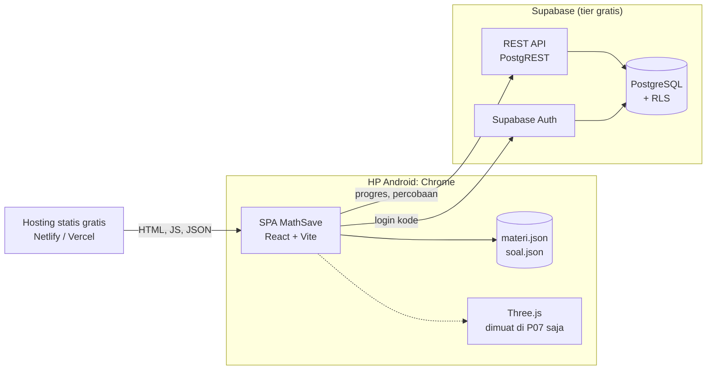
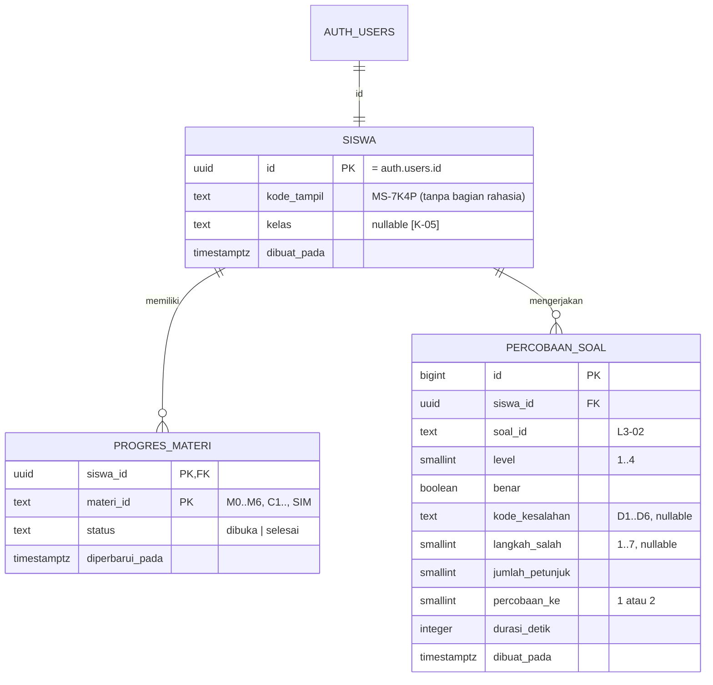
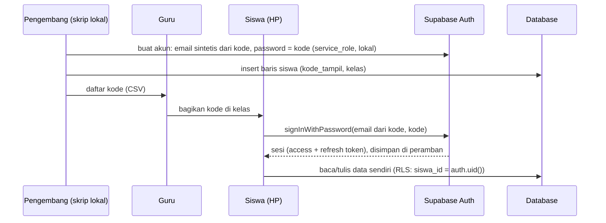

# Architecture — MathSave

Versi: 0.1 (draf, menunggu persetujuan) · Acuan: [PRD.md](PRD.md) · [api.md](api.md)

Butir bertanda **[Keputusan K-xx]** sudah disetujui pada 11 November 2026 (PRD §13). Butir bertanda **[Konfirmasi]** tanpa nomor masih terbuka.

---

## 1. Gambaran Arsitektur

MathSave adalah aplikasi web statis (Single Page Application) yang berbicara langsung dengan Supabase. Tidak ada server backend buatan sendiri.



Pembagian tanggung jawab:

| Bagian | Isi | Alasan |
|---|---|---|
| Frontend (statis) | Antarmuka, konten materi, bank soal, logika rumus, diagnosis kesalahan, fading | Konten jarang berubah; respons cepat tanpa menunggu server; hemat kuota |
| Supabase | Login, data progres, catatan percobaan | Data per siswa yang perlu disimpan permanen |

## 2. Teknologi Frontend

| Teknologi | Peran | Status |
|---|---|---|
| Vite | Build tool dan server pengembangan | [Keputusan K-01] |
| React (JavaScript) | Komponen antarmuka | [Keputusan K-01]; alternatif: JavaScript tanpa framework |
| React Router | Navigasi antarhalaman | Mengikuti K-01 |
| CSS biasa + custom properties | Gaya dan token warna ([design.md](design.md) §11) | Tanpa framework CSS, agar ringan |
| Three.js | Visualisasi 3D di P07 | [Spesifikasi]; versi dikunci saat development |
| @supabase/supabase-js | Klien Supabase | – |
| Vitest | Uji unit logika rumus dan diagnosis | – |

## 3. Teknologi Backend

Backend menggunakan **Supabase** sebagai *Backend-as-a-Service* (tier gratis): Auth, PostgreSQL, REST API otomatis (PostgREST), dan fungsi SQL (RPC). Tidak ada Edge Function yang wajib di P1.

Hal yang perlu diperhatikan pada tier gratis Supabase (perlu dicek ulang saat pembuatan proyek, karena kebijakan bisa berubah):
- Proyek **dijeda otomatis** jika tidak aktif sekitar satu minggu. Selama masa uji coba, proyek harus dibuka secara berkala atau dipulihkan dari dashboard.
- Batas ukuran database dan jumlah pengguna bulanan cukup untuk skala satu atau dua kelas.

## 4. Database Supabase



Konten materi dan soal **tidak** disimpan di database (lihat §1). Detail kolom dan kebijakan RLS ada di [api.md](api.md) §4.

## 5. Alur Autentikasi Kode Siswa

**[Keputusan K-03]** Rekomendasi: **Supabase Auth dengan satu akun per siswa**. Kode siswa berfungsi sebagai identitas sekaligus rahasia.

Format kode: `MS-XXXX-XXXX`. Terdiri dari 8 karakter acak dari 31 huruf/angka yang tidak mirip (tanpa O, 0, I, 1, L). Kode tidak bisa ditebak dan mudah dibaca siswa.



Rincian:
1. Siswa mengetik kode. Frontend menormalkan kode (huruf besar, menghapus spasi dan tanda "-").
2. Email sintetis = `<kode-ternormal>@<domain-sintetis>`, misalnya `ms7k4pq2xr@siswa.mathsave.app`. Email ini tidak pernah dipakai untuk mengirim surat. Konfirmasi email dimatikan, dan akun dibuat dengan `email_confirm: true`. Domain sintetis **[Konfirmasi]**.
3. Sesi disimpan oleh supabase-js dan diperbarui otomatis, sehingga siswa tidak perlu login ulang setiap kali membuka aplikasi (KFN-02).
4. Pembuatan akun dilakukan oleh skrip `supabase/scripts/buat-akun-siswa.js` yang dijalankan di komputer pengembang dengan kunci `service_role`. Kunci ini tidak pernah masuk ke frontend atau repositori **[Keputusan K-04]**.

Alternatif jika K-03 ditolak: fungsi RPC `masuk_dengan_kode` yang mengembalikan token sesi buatan sendiri. Kelemahannya: lebih banyak kode keamanan yang harus ditulis sendiri.

## 6. Integrasi Three.js

- Modul `src/three/AdeganBarang.js` diekspor sebagai fungsi `pasang(elemen, { hb, hj })` dan `perbarui({ hb, hj })`, serta `lepas()` untuk membersihkan memori saat halaman ditutup.
- Halaman P07 memuat modul ini dengan `import()` dinamis, sehingga Three.js tidak ikut dalam unduhan awal.
- Pemeriksaan WebGL dilakukan sebelum memuat. Jika gagal, ditampilkan komponen 2D `BarangDuaDimensi`.
- Render **on-demand**: `renderer.render()` hanya dipanggil saat slider berubah atau saat barang diputar.
- `devicePixelRatio` dibatasi maksimal 2 agar ringan di HP.
- Label harga berupa elemen HTML yang diposisikan di atas kanvas.

## 7. Alur Pertukaran Data

| Peristiwa | Data | Arah | Kapan |
|---|---|---|---|
| Buka aplikasi | `materi.json`, `soal.json` | Hosting → HP | Sekali; disimpan di cache peramban |
| Login | kode → sesi | HP ↔ Auth | Saat masuk |
| Buka Beranda/Progres | `ringkasan_progres()` | DB → HP | Setiap halaman dibuka |
| Selesai submateri | upsert `progres_materi` | HP → DB | Di kartu terakhir |
| Menjawab soal | insert `percobaan_soal` | HP → DB | Setiap jawaban akhir (bukan setiap langkah) |
| Simulasi | – | – | Tidak disimpan; hanya `progres_materi` (SIM) saat dibuka pertama kali |

Jika penyimpanan gagal (koneksi putus), data ditampung di antrean `localStorage` dan dikirim ulang saat online. Siswa tetap bisa melanjutkan belajar.

## 8. Struktur Folder Aplikasi (rencana)

Belum dibuat. Akan dibuat pada tahap Development setelah dokumentasi disetujui.

```text
mathsave/
├── README.md
├── AGENTS.md
├── docs/                         dokumentasi (PRD, design, architecture, api, task)
├── referensi/                    file wawancara [Keputusan K-10]
├── app/
│   ├── index.html
│   ├── package.json
│   ├── vite.config.js
│   ├── .env.example              VITE_SUPABASE_URL, VITE_SUPABASE_ANON_KEY
│   ├── public/
│   │   ├── data/materi.json      M0–M6, contoh bertahap
│   │   ├── data/soal.json        bank soal Level 1–4
│   │   └── gambar/               gambar barang 2D berlabel harga (SVG)
│   ├── src/
│   │   ├── main.jsx, App.jsx, rute.jsx
│   │   ├── halaman/              Masuk, Beranda, DaftarMateri, KartuMateri, KartuRumus,
│   │   │                         ContohBertahap, Simulasi, PilihLevel, Soal, Progres
│   │   ├── komponen/             LabelHarga, RumusTerisi, TeksBertanda, BilahLangkah,
│   │   │                         InputRupiah, InputPersen, TombolPilihan, TombolPetunjuk,
│   │   │                         LembarBawah, BatangBanding, NavBawah
│   │   ├── three/AdeganBarang.js
│   │   ├── logika/               hitung.js, diagnosis.js, fading.js, format.js
│   │   ├── layanan/              supabase.js, auth.js, progres.js, antrean.js
│   │   └── gaya/                 token.css, dasar.css
│   └── tests/                    hitung.test.js, diagnosis.test.js, format.test.js
└── supabase/
    ├── migrations/001_skema.sql
    └── scripts/buat-akun-siswa.js
```

## 9. Pertimbangan Keamanan

| Risiko | Penanganan |
|---|---|
| Kunci `service_role` bocor | Hanya dipakai di skrip lokal; `.env` masuk `.gitignore`; frontend hanya memakai `anon key` |
| Siswa membaca data siswa lain | RLS di semua tabel: `siswa_id = auth.uid()` |
| Menebak kode | 8 karakter acak (sekitar 8,5 × 10¹¹ kombinasi) + pembatasan percobaan login bawaan Supabase Auth |
| Data pribadi | Tidak ada nama asli, foto, atau kontak siswa (KNF-07). Identitas informan wawancara tidak dimuat di aplikasi maupun repositori |
| Kunci jawaban terlihat di `soal.json` | Diterima, karena latihan bersifat formatif (bukan nilai rapor). Jika latihan dipakai untuk penilaian resmi, pemeriksaan jawaban harus dipindah ke fungsi server **[Konfirmasi]** |
| Siswa memalsukan data progres | Risiko rendah dan dampak kecil (formatif); validasi tipe dan rentang lewat constraint database |
| XSS dari konten | Konten berasal dari JSON milik sendiri; tidak ada HTML dari pengguna yang dirender |
