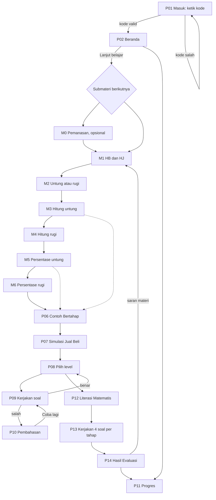
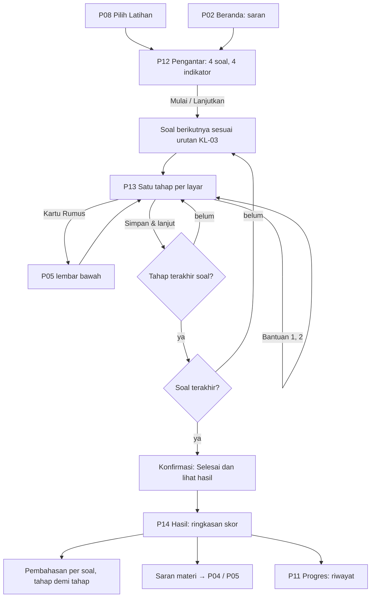

# Design — MathSave

Versi: 0.2 · Acuan kebutuhan: [PRD.md](PRD.md)

Riwayat: 0.1 disetujui 11 November 2026. **0.2 (disetujui 12 November 2026):** F14 Latihan Literasi Matematis dan Evaluasi: halaman P12–P14, alur, wireframe, komponen (§2, §3, §4, §5, §17).

ID fitur (F01–F14), kebutuhan (KP, KM, KT, KA), dan temuan (T1–T23) mengikuti PRD.

---

## 1. Konsep Desain

**"Satu layar, satu langkah."** MathSave adalah buku latihan digital yang tenang. Setiap layar hanya meminta satu hal dari siswa. Gambar selalu memuat harga barang. Rumus selalu ditampilkan bersama angka dari transaksi yang sedang dibahas.

Prinsip desain (dari prompt dan PRD Bagian 7):

| Prinsip | Penerapan | Bukti |
|---|---|---|
| Sederhana, tidak ramai | Maksimal 1 gambar dan 1 tugas per layar | T12, T23 |
| Bahasa mudah | Kalimat ≤ 15 kata; instruksi berupa perintah ("Tandai harga beli") | T8 |
| Bertahap | Kartu "Lanjut" dan "Kembali"; urutan langkah yang tetap | T4, T22 |
| Informasi penting mudah ditemukan | Warna dan label tetap untuk HB, HJ, Untung, Rugi, dan Ditanya | T9, T10 |
| Gambar relevan | Setiap gambar memuat label harga | T13 |
| Penjelasan pendek | ≤ 3 kalimat per kartu | T23 |
| Navigasi mudah | 4 tab bawah; tombol utama selalu di bawah layar (mudah dijangkau ibu jari) | KA1 |
| Animasi tidak berlebihan | Hanya transisi bermakna (angka berubah, label muncul) | T23 |
| Nyaman di Android | Mobile-first 360 px | KA3 |

## 2. Penerapan Cognitive Load Theory pada Antarmuka

| Komponen CLT | Teknik | Di mana |
|---|---|---|
| Intrinsic: dikelola | Segmentasi: rumus persentase dipecah menjadi 3 kartu (selisih → bagi HB → ×100%) | M5, M6, F12 |
| Intrinsic: dikelola | Urutan soal: angka langsung → cerita pendek → cerita panjang | F09 |
| Intrinsic: dikelola | Pemanasan prasyarat opsional | M0 |
| Extraneous: dikurangi | Integrasi (anti split-attention): rumus terisi angka di bawah gambar transaksi yang sama | F04, F07, F12 |
| Extraneous: dikurangi | Penandaan (signaling): warna dan label konsisten | F06 |
| Extraneous: dikurangi | Menghapus redundansi: tanpa gambar dekoratif, maskot, atau latar bergambar | Semua |
| Extraneous: dikurangi | Tempo dikendalikan siswa | F03, F12 |
| Germane: didorong | Worked example → completion problem → latihan mandiri (fading) | F12 → F09 |
| Germane: didorong | Self-explanation: pertanyaan "Mengapa?" berbentuk pilihan | F09, F10 |
| Germane: didorong | Variasi konteks dengan struktur sama | F09 |
| Germane: didorong | Langkah Periksa (hitung balik) | F05 |
| Intrinsic: dikelola | Soal Literasi Matematis dipecah per tahap; urutan dari yang sederhana [Usulan KL-03] | F14 |
| Extraneous: dikurangi | Soal di panel buka-tutup dengan tanda buatan siswa; satu tugas per layar | F14 |
| Germane: didorong | Memilih rumus/model dan alasan; menilai pernyataan orang lain (Soal 4); bantuan 2 tingkat | F14 |

## 3. Struktur Halaman

| Kode | Halaman | Fitur | Akses |
|---|---|---|---|
| P01 | Masuk | F01 | Awal (tanpa sesi) |
| P02 | Beranda (Dashboard) | F02, F13 | Tab "Beranda" |
| P03 | Daftar Materi | F03 | Tab "Materi" |
| P04 | Kartu Materi (M0–M6) | F03, F08 (2D) | Dari P03 / P02 |
| P05 | Kartu Rumus | F04 | Dari P03, P04, dan tombol "Rumus" di P09 (lembar bawah) |
| P06 | Contoh Bertahap | F12 | Dari akhir M3–M6 dan dari P03 |
| P07 | Simulasi Jual Beli | F07, F08 (3D) | Dari P03 dan P02 |
| P08 | Pilih Level Latihan | F09 | Tab "Latihan" |
| P09 | Mengerjakan Soal | F05, F06, F11 | Dari P08 |
| P10 | Pembahasan | F10 | Otomatis setelah jawaban salah (lembar bawah / layar penuh) |
| P11 | Progres | F13, F14 | Tab "Progres" |
| P12 | Pengantar Latihan Literasi Matematis | F14 | Dari P08 dan saran di P02 |
| P13 | Mengerjakan Soal Literasi Matematis | F14 | Dari P12 |
| P14 | Hasil Evaluasi Literasi Matematis | F14 | Otomatis setelah soal terakhir; dari P11 (riwayat) |

Isi submateri (P04):

| ID | Judul | Isi inti | Jumlah kartu (perkiraan) |
|---|---|---|---|
| M0 | Pemanasan (opsional) | Perkalian, pembagian, "persen = per seratus" | 3 |
| M1 | Harga Beli dan Harga Jual | HB = harga saat pedagang membeli; HJ = harga saat pedagang menjual | 3 |
| M2 | Untung atau Rugi? | HJ > HB → untung; HJ < HB → rugi; HJ = HB → impas | 3 |
| M3 | Menghitung Untung | Untung = HJ − HB | 3 |
| M4 | Menghitung Rugi | Rugi = HB − HJ | 3 |
| M5 | Persentase Untung | (Untung ÷ HB) × 100%; **mengapa dibagi HB** | 5 |
| M6 | Persentase Rugi | (Rugi ÷ HB) × 100% | 4 |

"Impas" disebut singkat di M2 agar siswa tidak bingung jika HJ = HB. Konsep ini tidak dilatih secara khusus.

## 4. User Flow



Alur F14 rinci ada di §17.2 (ditambahkan 12 November 2026).

Aturan alur:
- Submateri bisa dibuka bebas, tetapi P02 selalu menyarankan **satu** langkah berikutnya (tombol "Lanjut belajar").
- Level latihan terbuka berurutan: Level n+1 terbuka setelah 4 dari 5 soal Level n benar **[Asumsi]**, angka perlu dikonfirmasi.

## 5. Navigasi

- **Tab bawah** (4 tab, ikon + teks): Beranda · Materi · Latihan · Progres.
- Tab bawah **disembunyikan** di P04, P06, P09, P13, dan P14 (mode fokus). Diganti tombol "←" di kiri atas dan bilah langkah, misalnya "Langkah 3 dari 7".
- Tombol aksi utama selalu di bagian bawah layar, selebar layar, tinggi 48 px.
- Tombol "Rumus" di P09 membuka P05 sebagai **lembar bawah** (bottom sheet), sehingga jawaban tidak hilang.

## 6. Wireframe (lebar 360 px)

### P01 Masuk
```
┌──────────────────────────────┐
│                              │
│        MathSave              │
│  Belajar persentase untung   │
│  dan rugi                    │
│                              │
│  Kode siswa                  │
│  ┌────────────────────────┐  │
│  │ MS-____-____           │  │
│  └────────────────────────┘  │
│  Kode diberikan oleh guru.   │
│                              │
│  ┌────────────────────────┐  │
│  │        Masuk           │  │
│  └────────────────────────┘  │
└──────────────────────────────┘
Jika salah: "Kode tidak ditemukan. Periksa lagi hurufnya."
```

### P02 Beranda (Dashboard)
```
┌──────────────────────────────┐
│ Halo, MS-7K4P          [Keluar]│
├──────────────────────────────┤
│ Persentase Untung dan Rugi   │
│ ▓▓▓▓▓▓░░░░  4 dari 7 materi  │
│                              │
│ ┌──────────────────────────┐ │
│ │ Berikutnya:              │ │
│ │ M5 Persentase Untung     │ │
│ │ [ Lanjut belajar ]       │ │
│ └──────────────────────────┘ │
│                              │
│ Latihan      Level 1 ✓       │
│              Level 2 ▸       │
│ Simulasi Jual Beli      ▸    │
├──────────────────────────────┤
│ Beranda  Materi Latihan Progres│
└──────────────────────────────┘
```

### P04 Kartu Materi (contoh M5, kartu 3 dari 5)
```
┌──────────────────────────────┐
│ ←  Persentase Untung   3/5   │
├──────────────────────────────┤
│   ┌──────────┐               │
│   │  [tas]   │ Beli Rp80.000 │  ← label biru (HB)
│   │          │ Jual Rp100.000│  ← label oranye (HJ)
│   └──────────┘               │
│                              │
│ Untung = Rp20.000            │
│                              │
│ Persentase dihitung dari     │
│ HARGA BELI, karena itu uang  │
│ yang dikeluarkan pedagang.   │
│                              │
│   20.000                     │
│  ────────  × 100% = 25%      │
│   80.000  ← harga beli       │
├──────────────────────────────┤
│ [ Kembali ]     [ Lanjut ]   │
└──────────────────────────────┘
```

### P05 Kartu Rumus (lembar bawah)
```
┌──────────────────────────────┐
│ ▬▬  Kartu Rumus          ✕   │
│ ▲ Untung = HJ − HB           │
│ ▼ Rugi   = HB − HJ           │
│ % Untung = Untung ÷ HB × 100%│
│ % Rugi   = Rugi ÷ HB × 100%  │
│ HB = harga beli              │
│ HJ = harga jual              │
│ Ingat: persen selalu dibagi  │
│ HARGA BELI.                  │
│ [ Lihat contoh ]             │
└──────────────────────────────┘
```

### P06 Contoh Bertahap
Sama dengan P04, tetapi berisi satu soal utuh yang diselesaikan dengan 7 langkah (§8). Setiap ketukan "Lanjut" membuka satu langkah baru di bawah langkah sebelumnya. Langkah sebelumnya tetap terlihat tetapi diredupkan. Tombol "Ulangi dari awal" ada di langkah terakhir.

Varian fading: **Contoh Sebagian**, yaitu langkah 4–6 dikosongkan untuk diisi siswa. Contoh ini muncul sebelum Latihan Level 2 (Level 1 tidak memuat persentase).

### P07 Simulasi Jual Beli
```
┌──────────────────────────────┐
│ ←  Simulasi Jual Beli        │
├──────────────────────────────┤
│ ┌──────────────────────────┐ │
│ │      [ tas 3D ]          │ │  ← bisa diputar
│ │  Beli Rp80.000           │ │
│ │  Jual Rp100.000          │ │
│ └──────────────────────────┘ │
│ Harga beli   [ − ] 80.000 [+]│
│ ═════════●══════════         │
│ Harga jual   [ − ] 100.000[+]│
│ ═══════════●════════         │
│                              │
│ HB ████████                  │
│ HJ ██████████  ▲ UNTUNG      │
│                              │
│ Untung = 100.000 − 80.000    │
│        = Rp20.000            │
│ % = 20.000 ÷ 80.000 × 100%   │
│   = 25%                      │
├──────────────────────────────┤
│ [ Tantangan: buat rugi 10% ] │
└──────────────────────────────┘
```

### P09 Mengerjakan Soal (Level 3, langkah 1: menandai)
```
┌──────────────────────────────┐
│ ←  Level 3 · Soal 2/5        │
│ ●●○○○○○  Langkah 1: Tandai   │
├──────────────────────────────┤
│ Bu Rina membeli 1 tas seharga│
│ [Rp80.000]. Tas itu dijual   │
│ [Rp100.000]. Berapa persen   │
│ [keuntungan Bu Rina?]        │
│                              │
│ Ketuk bagian soal, lalu pilih│
│ labelnya:                    │
│ [Harga beli][Harga jual]     │
│ [Untung/Rugi][Ditanya]       │
├──────────────────────────────┤
│ [💡 Petunjuk 2]  [ Rumus ]   │
│ [        Lanjut           ]  │
└──────────────────────────────┘
```

### P10 Pembahasan (lembar bawah setelah jawaban salah)
```
┌──────────────────────────────┐
│ ▬▬                           │
│ Belum tepat di Langkah 6     │
│ Kamu menulis 20%.            │
│ Sepertinya kamu membagi      │
│ dengan HARGA JUAL (100.000). │
│                              │
│ Ingat: persentase untung     │
│ dihitung dari harga beli.    │
│                              │
│ Petunjuk: 20.000 ÷ 80.000 =  │
│ ...                          │
│ [ Coba lagi ]                │
│ [ Lihat penyelesaian ]       │
└──────────────────────────────┘
```

### P11 Progres
```
┌──────────────────────────────┐
│ Progres Belajar              │
├──────────────────────────────┤
│ Materi                       │
│ ✓ M1 Harga beli & jual       │
│ ✓ M2 Untung atau rugi        │
│ ✓ M3 Hitung untung           │
│ ✓ M4 Hitung rugi             │
│ ○ M5 Persentase untung       │
│ ○ M6 Persentase rugi         │
│ Latihan                      │
│ Level 1  ✓ 5/5 benar         │
│ Level 2  ▸ 2/5 benar         │
│ Level 3  🔒                  │
│ Level 4  🔒                  │
├──────────────────────────────┤
│ Beranda  Materi Latihan Progres│
└──────────────────────────────┘
```

Progres tidak memakai skor ranking atau perbandingan dengan teman (tidak ada bukti kebutuhan, dan berisiko menambah tekanan).

## 7. Komponen Antarmuka

| Komponen | Fungsi | Dipakai di |
|---|---|---|
| `LabelHarga` | Label HB (biru) / HJ (oranye) dengan teks "Beli" / "Jual" + angka | P04, P06, P07 |
| `KartuMateri` | Satu kartu: gambar opsional + ≤ 3 kalimat + rumus terisi | P04, P06 |
| `RumusTerisi` | Pecahan bertingkat dengan angka dan keterangan pembilang/penyebut | P04, P05, P06, P07, P10 |
| `TeksBertanda` | Soal yang segmennya bisa diketuk dan diberi label | P09 |
| `BilahLangkah` | Indikator "Langkah n dari 7" | P06, P09 |
| `InputRupiah` | Input angka dengan pemisah ribuan otomatis dan keyboard numerik | P07, P09 |
| `InputPersen` | Input persen; menerima koma dan titik | P09 |
| `TombolPilihan` | Pilihan besar (Untung / Rugi; pilihan rumus; alasan) | P09 |
| `TombolPetunjuk` | Membuka petunjuk tingkat berikutnya; menampilkan sisa petunjuk | P09 |
| `LembarBawah` | Bottom sheet untuk Rumus dan Pembahasan | P05, P10 |
| `BatangBanding` | Dua batang horizontal HB dan HJ, selisih diarsir | P04 (M2), P07 |
| `NavBawah` | 4 tab | P02, P03, P08, P11 |
| `AdeganBarang3D` | Kanvas Three.js barang + label harga | P07 saja |

Komponen F14 (`BilahSkor`, `KartuIndikator`, `PanelSoal`, `RingkasHarga`, `BarisTahap`, `TombolBantuan`) ada di §17.7.

## 8. Panduan Langkah demi Langkah (F05)

| No | Langkah | Interaksi | Diperiksa | Indikator ML |
|---|---|---|---|---|
| 1 | Identifikasi informasi yang diketahui | Ketuk segmen soal lalu pilih label (F06) | Label cocok dengan kunci | Merumuskan |
| 2 | Tentukan HB dan HJ | Kotak HB dan HJ terisi otomatis dari langkah 1; siswa mengonfirmasi | Nilai | Merumuskan |
| 3 | Untung atau rugi? | Pilih ▲ Untung / ▼ Rugi + pilih alasan ("karena HJ lebih besar dari HB") | Jenis + alasan | Penalaran |
| 4 | Hitung besar untung/rugi | `InputRupiah` | Nilai | Menggunakan |
| 5 | Pilih rumus persentase | 3 kartu pilihan: `Untung ÷ HB × 100%`, `Untung ÷ HJ × 100%`, `Untung × HB ÷ 100` | Pilihan | Menggunakan |
| 6 | Hitung persentase | `InputPersen` | Nilai (toleransi ±0,01) | Menggunakan |
| 7 | Periksa kembali | Hitung balik: "25% × 80.000 = ?" lalu pilih "Apakah hasilnya masuk akal?" | Nilai + pilihan | Menafsirkan |

**Fading per level:**

| Level | Bentuk soal | Panduan | Petunjuk tersedia |
|---|---|---|---|
| 1 | HB dan HJ diberikan langsung (tanpa cerita); tanya jenis + alasan + besar. **Tanpa persentase** | Langkah 2, 3, 4, dan 7 (langkah 1 dan 5–6 tidak dipakai) | 4 tingkat (tingkat "rumus" berisi rumus untung/rugi) |
| 2 | HB dan HJ langsung; tanya persentase | 7 langkah penuh | 4 tingkat |
| 3 | Cerita pendek (2–3 kalimat) | Diringkas menjadi 3 tahap: Tandai → Hitung (jenis, besar, persen) → Periksa | 2 tingkat (identifikasi, rumus) |
| 4 | Cerita lebih panjang, ada angka pengecoh atau dua transaksi untuk dibandingkan | Tanpa panduan; isi **HB dan HJ** → pilih jenis → isi persen → pilih alasan (D-05 §3.2) | 0 (pembahasan tetap muncul setelah menjawab) |

**Fading per siswa** **[Asumsi]**: di Level 1–2, jika siswa menjawab 3 soal berturut-turut benar tanpa petunjuk, panduan untuk soal berikutnya diringkas menjadi 3 tahap seperti Level 3.

## 9. Petunjuk Bertingkat (F11)

| Tingkat | Isi | Contoh |
|---|---|---|
| 1. Identifikasi | Mengarahkan ke informasi | "Cari kata 'membeli' di soal. Angka sesudahnya adalah harga beli." |
| 2. Rumus | Menunjukkan rumus yang sesuai | "Persentase untung = Untung ÷ Harga Beli × 100%" |
| 3. Operasi | Menunjukkan operasi dengan angka | "Hitung 20.000 ÷ 80.000 dulu." |
| 4. Penyelesaian | Hampir lengkap | "20.000 ÷ 80.000 = 0,25. Sekarang kalikan 100%." |

Petunjuk dibuka berurutan. Jumlah petunjuk yang dipakai dicatat (KK5).

## 10. Latihan dan Pembahasan (F09, F10)

### 10.1 Bank soal (rencana awal)

| Level | Jumlah soal | Contoh konteks |
|---|---|---|
| 1 | 6 | Pedagang buah, penjual pulsa |
| 2 | 6 | Pedagang baju, warung |
| 3 | 6 | Toko online, kantin sekolah |
| 4 | 5 | Membeli 1 lusin lalu menjual per buah; membandingkan dua pedagang |

Setiap sesi menampilkan 5 soal acak dari level tersebut. Level 1 tidak memuat persentase. Angka dipilih agar persentasenya bilangan bulat di Level 2–3. Contoh soal disusun baru oleh pengembang; **soal pemicu wawancara (Rp100.000 → Rp120.000) boleh dipakai sebagai contoh pertama** karena berasal dari dokumen sumber.

### 10.2 Diagnosis kesalahan dan pembahasan

Setiap pembahasan memuat 4 unsur sesuai prompt: **bagian yang belum tepat → konsep terkait → petunjuk memperbaiki → contoh penyelesaian benar**.

| Kode | Kesalahan | Cara mengenali | Konsep yang ditampilkan | Bukti |
|---|---|---|---|---|
| D1 | Membagi dengan HJ | Jawaban = selisih ÷ HJ × 100 | "Persen dihitung dari harga beli" | T2 |
| D2 | Lupa × 100% | Jawaban = selisih ÷ HB | "Persen artinya per seratus" | T5 |
| D3 | Tertukar untung/rugi | Jenis salah | Bandingkan HJ dan HB | T3 |
| D4 | Selisih salah | Langkah 4 ≠ \|HJ − HB\| | Rumus untung / rugi | T7 |
| D5 | HB/HJ salah ditentukan | HB/HJ tertukar, memakai angka pengecoh, atau belum dikalikan jumlah barang | Arti membeli dan menjual | T9 |
| D6 | Lainnya | Tidak cocok pola apa pun | Tampilkan langkah yang salah + contoh | – |

Alur: salah pertama → tampilkan unsur 1–3 lalu "Coba lagi"; salah kedua → tampilkan contoh penyelesaian lengkap (unsur 4) lalu lanjut ke soal berikutnya.

## 11. Palet Warna

Warna memiliki makna tetap dan selalu disertai teks atau ikon (KNF-06).

| Token | Hex | Makna | Pasangan teks / ikon |
|---|---|---|---|
| `--latar` | `#FFFFFF` | Latar halaman | – |
| `--permukaan` | `#F4F6F8` | Kartu | – |
| `--teks` | `#1F2933` | Teks utama | – |
| `--teks-redup` | `#52606D` | Keterangan | – |
| `--aksi` | `#0F766E` | Tombol utama | – |
| `--hb` | `#1D4ED8` | Harga beli | label "Beli" |
| `--hj` | `#C2410C` | Harga jual | label "Jual" |
| `--untung` | `#15803D` | Untung | ikon ▲ + kata "Untung" |
| `--rugi` | `#B91C1C` | Rugi | ikon ▼ + kata "Rugi" |
| `--ditanya` | `#7C3AED` | Hal yang ditanyakan | garis bawah + label "Ditanya" |
| `--petunjuk` | `#FEF3C7` | Latar petunjuk | ikon 💡 |

Kontras teks putih di atas `--aksi`, `--hb`, `--hj`, `--untung`, `--rugi`, dan `--ditanya` perlu diverifikasi saat implementasi (target ≥ 4,5:1). Mode gelap tidak termasuk P1.

## 12. Tipografi

- Fonta: *system font stack* (Roboto di Android), tanpa unduhan fonta, sehingga lebih ringan.
- Ukuran: isi 16 px · keterangan 14 px · judul 20 px · judul halaman 24 px · angka rumus 18 px.
- Angka memakai `font-variant-numeric: tabular-nums` agar sejajar pada rumus.
- Tinggi baris 1,5. Lebar teks maksimal sekitar 60 karakter.

## 13. Desain Responsif Android

- Mobile-first: rancangan dasar 360 × 640 px; diuji juga di 412 px.
- Di layar ≥ 768 px (tablet/laptop), konten tetap satu kolom dengan lebar maksimal 480 px di tengah.
- Margin samping 16 px. Area sentuh ≥ 44 px. Jarak antartombol ≥ 8 px.
- Input memakai `inputmode="numeric"` (rupiah) dan `inputmode="decimal"` (persen).
- Ketika keyboard muncul, tombol "Lanjut" tetap terlihat (tidak tertutup keyboard).
- Orientasi utama potret.
- Tombol "Kembali" Android harus berfungsi seperti tombol "←" di aplikasi (riwayat navigasi peramban).

## 14. Rancangan Visualisasi Three.js

Keputusan 11 November 2026: **3D hanya di P07 Simulasi Jual Beli.**

| Aspek | Rancangan |
|---|---|
| Objek | Satu barang dagangan low-poly (usulan: tas sekolah **[Keputusan K-06]**), dibuat dari bentuk dasar Three.js, tanpa file model eksternal |
| Fungsi pembelajaran | Mengaitkan konsep abstrak dengan barang nyata: dua label harga (Beli/biru, Jual/oranye) menempel di barang dan **berubah saat slider digeser**. Warna dan ikon untung/rugi muncul di dekat barang |
| Interaksi | Diputar dengan geser satu jari (rotasi horizontal saja); tanpa zoom dan geser posisi |
| Label | Elemen HTML di atas kanvas (bukan teks 3D), agar tajam dan mudah dibaca |
| Animasi | Tidak ada animasi berputar otomatis. Render hanya saat ada interaksi (hemat baterai) |
| Ukuran | Kanvas maksimal sekitar 40% tinggi layar; slider dan hasil tetap terlihat tanpa gulir |
| Cadangan | Jika WebGL tidak tersedia atau gagal dimuat → gambar 2D barang dengan label yang sama |
| Pemuatan | Three.js dimuat hanya saat P07 dibuka |

Yang **tidak** dibuat: adegan toko, karakter pedagang, efek partikel, atau koin berjatuhan (dekoratif).

## 15. Desain Materi

Setiap kartu materi mengikuti pola: **gambar transaksi (jika perlu) → 1–3 kalimat → rumus terisi angka**. Contoh angka di M3, M5 dan M4, M6 memakai transaksi yang sama, agar siswa melihat hubungan antara besar untung/rugi dan persentasenya.

| Submateri | Transaksi contoh |
|---|---|
| M3, M5 | Tas: beli Rp80.000, jual Rp100.000 → untung Rp20.000 → 25% |
| M4, M6 | Sepatu: beli Rp50.000, jual Rp40.000 → rugi Rp10.000 → 20% |

Kartu "mengapa dibagi harga beli" (M5) memakai penjelasan konseptual sederhana: persentase membandingkan untung dengan modal pedagang, yaitu uang yang dikeluarkan saat membeli.

## 16. Desain Simulasi Jual Beli (F07)

- **Mode bebas:** siswa menggeser HB dan HJ (Rp10.000–Rp200.000, kelipatan Rp5.000). Hasil (jenis, besar, persen) dan rumus terisi berubah langsung.
- **Mode tantangan** (3 tantangan; titik awal T1 = HB Rp40.000, T2 = HB Rp50.000, T3 = HB Rp80.000 terkunci, sehingga cukup menggeser harga jual. Keputusan 11 November 2026): "Buat pedagang untung 25%", "Buat pedagang rugi 10%", "HB tetap Rp80.000. Berapa HJ agar untung Rp20.000?". Siswa mengatur slider lalu menekan "Cek". Tantangan ini melatih penalaran dan penafsiran, bukan rumus kebalikan formal.
- Hasil memakai `BatangBanding`: batang HB dan HJ, dengan selisih diarsir hijau (untung) atau merah (rugi).

## 17. Latihan Literasi Matematis dan Evaluasi (F14)

Ditambahkan 12 November 2026. Soal, kunci, indikator, dan bobot adalah **[Spesifikasi]** ([PRD](PRD.md) §8.3–8.5). Semua rancangan tampilan di bagian ini adalah **[Usulan]** yang **disetujui 12 November 2026** (PRD §13.1). Isi tahap, rubrik, dan umpan balik ada di [D-08](konten/D-08_literasi_matematis.md).

### 17.1 Posisi dalam aplikasi

| Hal | Rancangan [Usulan] |
|---|---|
| Pintu masuk | Kartu "Latihan Literasi Matematis" di P08 (di bawah Level 1–4), dan saran di P02 Beranda (KL-09) |
| Halaman | P12 Pengantar → P13 Mengerjakan (23 tahap) → P14 Hasil Evaluasi |
| Mode fokus | P13 dan P14 tanpa tab bawah, sama dengan P09 |
| Keluar di tengah | Tombol "←" bertanya "Keluar dulu? Jawabanmu tersimpan di HP ini." Siswa bisa melanjutkan nanti (KFN-26) |

### 17.2 Alur



Antara dua soal tampil layar jeda singkat: "Soal 4 selesai. Berikutnya Soal 2." Layar ini memberi kesempatan istirahat dan tidak menampilkan skor (KL-08).

### 17.3 Wireframe P12 Pengantar

```
┌──────────────────────────────┐
│ ←  Latihan Literasi Matematis│
├──────────────────────────────┤
│ 4 soal cerita jual beli.     │
│ Kerjakan tahap demi tahap.   │
│ Hasilnya muncul di akhir.    │
│                              │
│ ┌──────────────────────────┐ │
│ │ Soal 3  Employing …      │ │
│ │ Soal 4  Interpreting …   │ │
│ │ Soal 2  Formulating …    │ │
│ │ Soal 1  Reasoning        │ │
│ └──────────────────────────┘ │
│ Skor maksimal 24.            │
│ Ada bantuan di setiap tahap. │
│                              │
│ Hasil terakhir: 18 dari 24   │  ← hanya jika pernah mengerjakan
├──────────────────────────────┤
│ [          Mulai           ] │  ← "Lanjutkan (Soal 2, tahap 3)" bila ada jawaban tersimpan
└──────────────────────────────┘
```

### 17.4 Wireframe P13 Mengerjakan (contoh Soal 1, tahap 3)

```
┌──────────────────────────────┐
│ ←  Soal 1 · Tahap 3 dari 5   │
│ ●●●○○                        │
├──────────────────────────────┤
│ ▸ Lihat soal                 │  ← panel buka-tutup; tanda HB/HJ buatan siswa
│ ┌──────────────────────────┐ │
│ │ Toko A  Beli Rp120.000   │ │  ← ringkasan dari tanda siswa
│ │ Toko B  Beli Rp140.000   │ │     di tahap 1 (bukan kunci)
│ │ Toko C  Beli Rp160.000   │ │
│ └──────────────────────────┘ │
│ Pilih rumus persentase       │
│ keuntungan.                  │
│ ( ) Untung ÷ HJ × 100%       │
│ ( ) Untung ÷ HB × 100%       │
│ ( ) Untung × HB ÷ 100        │
│                              │
│ Hitung untuk setiap toko.    │
│ Toko A [      ] %            │
│ Toko B [      ] %            │
│ Toko C [      ] %            │
├──────────────────────────────┤
│ [💡 Bantuan 1/2]  [ Rumus ]  │
│ [     Simpan & lanjut      ] │  ← aktif setelah semua isian terisi
└──────────────────────────────┘
```

Aturan tampilan P13 [Usulan]:
- Satu tugas per layar. Pengecualian: ML-1 tahap 3 memuat rumus dan tiga isian karena keduanya satu tahap berbobot 2 (spesifikasi). Bila layar 360 px terlalu padat saat diuji, bagian ini dipecah menjadi dua layar dalam tahap yang sama.
- Tahap 1 setiap soal memakai `TeksBertanda` (F06). Di tahap berikutnya, soal ditampilkan di panel "Lihat soal" lengkap dengan tanda buatan siswa.
- Ringkasan harga di tahap 2 dan seterusnya diambil dari tanda siswa. Jika tanda salah, ringkasan ikut salah, dan penilaian konsekuen berlaku (D-08 §4.1 U4).
- Tidak ada tanda ✓/✗ selama pengerjaan (KL-08).
- Bantuan dibuka satu tingkat per ketukan dan tampil di kotak kuning di bawah instruksi.

### 17.5 Wireframe P14 Hasil Evaluasi

Hasil dibuka bertahap dalam tiga bagian agar tidak padat (ketentuan D: penjelasan bertahap).

**Bagian 1: Ringkasan skor**

```
┌──────────────────────────────┐
│ ←  Hasil Latihan             │
├──────────────────────────────┤
│ Skormu                       │
│        18 dari 24            │
│ ▓▓▓▓▓▓▓▓▓▓▓▓▓▓▓░░░░░         │
│ Naik 4 dari percobaan lalu.  │  ← hanya jika ada percobaan sebelumnya
│                              │
│ 1 Mathematical Reasoning     │
│   Bernalar: membandingkan…   │
│   ▓▓▓▓▓░  5 dari 6           │
│   Hampir semua tepat.        │
│ 2 Formulating Situations …   │
│   ▓▓▓░░░  3 dari 6           │
│   Sebagian sudah tepat.      │
│ 3 Employing … Procedures     │
│   ▓▓▓▓▓▓  6 dari 6  ✓        │
│ 4 Interpreting … Outcomes    │
│   ▓▓▓▓░░  4 dari 6           │
├──────────────────────────────┤
│ [   Lihat pembahasan    ]    │
└──────────────────────────────┘
```

**Bagian 2: Pembahasan per soal** (daftar soal, lalu satu soal dibuka)

```
┌──────────────────────────────┐
│ ←  Pembahasan Soal 2         │
│    Formulating · 3 dari 6    │
├──────────────────────────────┤
│ ✓ Tahap 1 Diketahui  Sudah benar │
│ ✓ Tahap 2 Ditanya    Sudah benar │
│ ✗ Tahap 3 Model      Perlu diperbaiki │
│ ┌──────────────────────────┐ │
│ │ Jawabanmu:               │ │
│ │ Keuntungan = 20% × HJ    │ │
│ │ Soal menyebut "20% dari  │ │
│ │ harga beli". Jadi dikali │ │
│ │ harga beli.              │ │
│ │ Yang benar:              │ │
│ │ 20% × 250.000 = 50.000   │ │
│ └──────────────────────────┘ │
│ ✗ Tahap 4 …                  │  ← tertutup; ketuk untuk membuka
│ ✓ Tahap 5 …                  │
│ ✗ Tahap 6 …                  │
├──────────────────────────────┤
│ [ Lihat penyelesaian lengkap ]│  ← Contoh Bertahap: satu langkah per ketukan
│ [  Soal berikutnya  ›   ]    │
└──────────────────────────────┘
```

**Bagian 3: Saran belajar**

```
┌──────────────────────────────┐
│ ←  Saran Belajar             │
├──────────────────────────────┤
│ Pelajari lagi bagian ini:    │
│ ▸ M5 Persentase Untung       │
│   Mengapa dibagi harga beli  │
│ ▸ Kartu Rumus                │
│ ▸ M1 Harga Beli dan Jual     │
│                              │
│ Kamu memakai 3 bantuan.      │
│                              │
├──────────────────────────────┤
│ [ Coba lagi ]  [ Selesai ]   │
└──────────────────────────────┘
```

Aturan tampilan P14 [Usulan]:
- Ringkasan skor tampil lebih dulu. Pembahasan dan saran dibuka dengan ketukan (tempo diatur siswa, T22).
- Setiap tahap memakai label teks **"Sudah benar"** atau **"Perlu diperbaiki"** beserta ikon ✓/✗. Warna tidak menjadi satu-satunya penanda (KNF-06).
- Pembahasan tahap yang perlu diperbaiki memuat 4 unsur F10: jawaban siswa → konsep → cara memperbaiki → hasil yang benar.
- "Lihat penyelesaian lengkap" menampilkan kunci [Spesifikasi] satu baris per ketukan, sama seperti Contoh Bertahap (F12).
- Tanpa peringkat, tanpa perbandingan dengan teman, dan tanpa kata "lulus/gagal" (KL-11).
- Nama indikator memakai nama lengkap bahasa Inggris dengan keterangan bahasa Indonesia di bawahnya (KL-12). Pada lebar 360 px, nama panjang boleh turun ke baris kedua dan tidak dipotong.

### 17.6 Wireframe tambahan P11 Progres (bagian Literasi Matematis)

```
│ Literasi Matematis           │
│ Pertama   12 Nov   14 dari 24│
│ Terakhir  15 Nov   19 dari 24│
│ Naik 5 poin.                 │
│ R ▓▓▓▓▓░  F ▓▓▓▓░░           │
│ E ▓▓▓▓▓▓  I ▓▓▓▓░░           │  ← singkatan disertai legenda
│ [ Lihat semua percobaan ]    │
```

### 17.7 Komponen baru [Usulan]

| Komponen | Fungsi | Dipakai di |
|---|---|---|
| `BilahSkor` | Bilah skor "x dari 6" / "x dari 24" dengan teks angka | P12, P14, P11 |
| `KartuIndikator` | Nama indikator + keterangan + `BilahSkor` + pesan | P14 |
| `PanelSoal` | Teks soal buka-tutup dengan tanda buatan siswa | P13 |
| `RingkasHarga` | Daftar harga hasil tanda siswa (per toko / barang) | P13 |
| `BarisTahap` | Satu tahap di pembahasan: status, jawaban siswa, umpan balik | P14 |
| `TombolBantuan` | Membuka bantuan tingkat 1–2; menampilkan sisa bantuan | P13 (varian dari `TombolPetunjuk`) |

Komponen yang dipakai ulang: `TeksBertanda`, `TombolPilihan`, `InputRupiah`, `InputPersen`, `LembarBawah`, `IsiKartuRumus`, `BilahLangkah`, `KepalaFokus`.

Label baru di Penanda Informasi: **"Persen untung"** (ML-2 tahap 1). Warna memakai token `--untung` dengan tag teks "Persen", sehingga tidak bergantung pada warna saja.

### 17.8 Kenyamanan di Android [Usulan]

- Semua isian angka memakai `inputMode="numeric"` (rupiah) atau `inputMode="decimal"` (persen), agar keyboard angka muncul.
- Saat keyboard muncul, tombol "Simpan & lanjut" tetap terlihat (bilah bawah lengket di atas keyboard).
- Tombol Kembali Android di P13 sama dengan "←": bertanya dulu, lalu menyimpan jawaban sementara.
- Ukuran teks dan area sentuh mengikuti §12–13 (≥ 16 px, ≥ 44 px).
