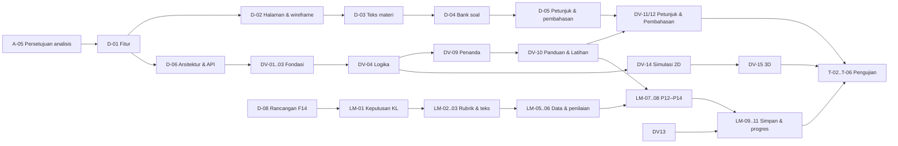

# Task — MathSave

Versi: 0.2 (12 November 2026: tambahan F14 di §8, menunggu persetujuan) · Acuan: [PRD.md](PRD.md) · [design.md](design.md) · [architecture.md](architecture.md)

Status: `[x]` selesai · `[~]` berjalan / menunggu persetujuan · `[ ]` belum.
Prioritas: P1 wajib · P2 penting · P3 opsional (sama dengan PRD §9).

Rencana waktu: sekitar 8 minggu, dihitung **sejak dokumentasi disetujui**.

---

## 1. Analysis

| ID | Tugas | Prio | Bergantung | Kriteria selesai | Status |
|---|---|---|---|---|---|
| A-01 | Memeriksa folder dan membaca seluruh dokumen wawancara | P1 | – | Ringkasan dan daftar ketidaksesuaian tersedia | [x] |
| A-02 | Konfirmasi data yang tidak konsisten (informan, kelas, video, 3D) | P1 | A-01 | 4 keputusan tercatat (11 November 2026) | [x] |
| A-03 | Identifikasi kebutuhan siswa dan analisis CLT | P1 | A-02 | PRD §5–7 | [x] |
| A-04 | Tabel Mathematical Literacy | P1 | A-03 | PRD §8 | [x] |
| A-05 | Persetujuan pemilik proyek atas analisis | P1 | A-03, A-04 | Persetujuan tertulis | [x] |

## 2. Design

| ID | Tugas | Prio | Bergantung | Kriteria selesai | Status |
|---|---|---|---|---|---|
| D-01 | Fitur dan prioritas | P1 | A-05 | PRD §9 disetujui | [x] |
| D-02 | Struktur halaman, user flow, navigasi, wireframe | P1 | D-01 | design.md §3–6 disetujui | [x] |
| D-03 | Rancangan materi M0–M6 (teks lengkap per kartu) | P1 | D-02 | Draf teks semua kartu; diperiksa pemilik proyek | [x] |
| D-04 | Penyusunan bank soal Level 1–4 + kunci + alasan | P1 | D-03 | Minimal 23 soal (design.md §10.1); semua angka diverifikasi | [x] |
| D-05 | Teks pembahasan D1–D6 dan petunjuk 4 tingkat per soal | P1 | D-04 | Setiap soal memiliki petunjuk dan pembahasan | [x] |
| D-06 | Arsitektur dan API | P1 | D-01 | architecture.md dan api.md disetujui; K-01 sampai K-05 terjawab | [x] |
| D-07 | Validasi rancangan materi dan media oleh ahli (dosen/guru) | P2 | D-03, D-04 | Lembar penilaian dan revisi | [ ] |
| D-08 | Rancangan F14 Latihan Literasi Matematis dan Evaluasi (rincian di §8) | P1 | Persyaratan 12 November 2026 | [D-08](konten/D-08_literasi_matematis.md) + dokumen terkait disetujui | [~] menunggu persetujuan |

## 3. Development

Hanya dimulai setelah A-05, D-01, D-02, dan D-06 disetujui.

| ID | Tugas | Prio | Bergantung | Kriteria selesai | Minggu |
|---|---|---|---|---|---|
| DV-01 | Inisialisasi proyek Vite, struktur folder, token CSS | P1 | D-06 | `npm run dev` berjalan; struktur sesuai architecture.md §8 | 1 · ✅ selesai 11 November 2026 |
| DV-02 | Proyek Supabase, migrasi skema + RLS | P1 | D-06 | Uji RLS: siswa A tidak bisa membaca data siswa B | 1 |
| DV-03 | Skrip pembuatan akun dan kode siswa | P1 | DV-02 | Menghasilkan CSV kode; akun bisa login | 1 |
| DV-04 | Logika `hitung.js`, `format.js`, `diagnosis.js` + uji unit | P1 | DV-01 | Semua uji lulus; D1–D5 dikenali | 2 · ✅ selesai 11 November 2026 (93 uji lulus) |
| DV-05 | F01 Login + sesi + keluar | P1 | DV-02, DV-03 | KFN-01, KFN-02 | 2 · 🔶 sebagian: halaman Masuk + mode uji tanpa server; login Supabase menunggu DV-02 |
| DV-06 | Kerangka navigasi + F02 Beranda | P1 | DV-05 | KFN-03 | 2 · ✅ selesai 11 November 2026 (kerangka navigasi, Beranda dengan progres sementara) |
| DV-07 | F03 Materi + F04 Kartu Rumus + gambar 2D berlabel harga | P1 | DV-06, D-03 | KFN-04 sampai KFN-06 | 3 · ✅ selesai 11 November 2026 (kartu M0–M6 + cek cepat, Kartu Rumus halaman dan lembar bawah; status selesai materi disimpan di DV-13) |
| DV-08 | F12 Contoh Bertahap (penuh dan sebagian) | P1 | DV-07 | KFN-15 | 3 |
| DV-09 | F06 Penanda Informasi (`TeksBertanda`) | P1 | DV-04 | KFN-08 | 4 · ✅ selesai 11 November 2026 (pratinjau di /latihan/tandai; dipasang ke halaman Soal di DV-10) |
| DV-10 | F05 Panduan Langkah + F09 Latihan Level 1–4 | P1 | DV-09, D-04 | KFN-07, KFN-11 | 4–5 |
| DV-11 | F11 Petunjuk Bertingkat + fading | P1 | DV-10, D-05 | KFN-14 | 5 |
| DV-12 | F10 Pembahasan | P1 | DV-10, D-05 | KFN-12, KFN-13 | 5 |
| DV-13 | Penyimpanan percobaan + antrean luring | P1 | DV-10, DV-02 | KFN-16; data masuk setelah koneksi kembali | 5 |
| DV-14 | F07 Simulasi versi 2D | P1 | DV-04 | KFN-09 | 6 · ✅ selesai 11 November 2026 |
| DV-15 | F08 Adegan 3D Three.js + cadangan 2D | P2 | DV-14 | KFN-10; dimuat hanya di P07 | 6 |
| DV-16 | F13 Halaman Progres | P2 | DV-13 | KFN-17 | 6 |

## 4. Testing

| ID | Tugas | Prio | Bergantung | Kriteria selesai | Minggu |
|---|---|---|---|---|---|
| T-01 | Uji unit (Vitest): rumus, format angka, diagnosis, fading | P1 | DV-04, DV-11 | Semua uji lulus | 2–6 |
| T-02 | Uji kotak hitam per fitur (KFN-01 sampai KFN-17) | P1 | DV-16 | Tabel hasil uji; semua P1 lulus | 7 |
| T-03 | Uji perangkat Android (minimal 2 HP, Chrome) | P1 | DV-16 | KNF-02 sampai KNF-04; catatan waktu muat | 7 |
| T-04 | Uji keterbatasan: koneksi lambat, WebGL mati, proyek Supabase dijeda | P1 | DV-13, DV-15 | Pesan kesalahan sesuai api.md §7 | 7 |
| T-05 | Uji keterbacaan teks dengan 1–2 siswa (bukan informan utama) | P1 | DV-07, DV-10 | Catatan dan revisi kalimat | 7 |
| T-06 | Uji pengguna berdasarkan Matriks H (KK1–KK6) | P1 | T-02 | Lembar observasi KK1–KK6 | 8 |
| T-07 | Pemeriksaan keamanan: RLS, kunci, `.gitignore` | P1 | DV-02 | Checklist architecture.md §9 lulus | 7 |

## 5. Deployment

| ID | Tugas | Prio | Bergantung | Kriteria selesai | Minggu |
|---|---|---|---|---|---|
| DP-01 | Hosting frontend gratis + variabel lingkungan | P1 | K-02, DV-05 | URL publik berjalan di HTTPS | 2 (awal), 8 (final) |
| DP-02 | Membuat dan membagikan kode siswa uji | P1 | DV-03 | CSV kode untuk guru | 8 |
| DP-03 | Panduan singkat penggunaan untuk guru dan siswa | P2 | DP-01 | Satu halaman PDF/MD | 8 |
| DP-04 | Pemantauan selama uji (mencegah Supabase dijeda) | P1 | DP-01 | Proyek aktif selama masa uji | 8+ |

## 6. Ketergantungan Utama

Jalur kritis: **A-05 → D-03 → D-04 → D-05 → DV-10 → DV-11/12 → T-06.** Penulisan konten (materi dan soal) adalah pekerjaan terbesar dan perlu dimulai segera setelah persetujuan.

## 7. Rencana Pengujian

| Jenis | Apa yang diuji | Cara | Bukti |
|---|---|---|---|
| Uji unit | `hitung.js` (4 rumus), `format.js` (Rp, koma), `diagnosis.js` (D1–D6), `fading.js` | Vitest, kasus normal dan batas (HJ = HB, HB = 0 ditolak) | Laporan Vitest |
| Kotak hitam | Setiap KFN | Tabel skenario → hasil yang diharapkan → hasil nyata | Tabel uji |
| Perangkat | Tampilan 360/412 px, keyboard, tombol Kembali, waktu muat | 2 HP Android + emulasi DevTools | Tangkapan layar + catatan |
| Keterbacaan | Kalimat materi dan soal | 1–2 siswa membaca, lalu ditanya maknanya | Catatan revisi |
| Uji pengguna | KK1–KK6 (PRD §12) | Observasi sesuai kolom "Cara menguji fitur" Matriks H | Lembar observasi |
| Keamanan | RLS, kunci, kode | Login sebagai dua siswa; coba membaca data siswa lain | Checklist |

## 8. Fitur F14 Latihan Literasi Matematis dan Evaluasi

Ditambahkan 12 November 2026 ([PRD](PRD.md) §8.3–8.6, §13.1 · [D-08](konten/D-08_literasi_matematis.md) · [design.md](design.md) §17 · [architecture.md](architecture.md) §10 · [api.md](api.md) §3.5–3.7, §4.1, §5.3).
**Coding F14 belum boleh dimulai** sampai LM-01 selesai. Status DV-01 sampai DV-07 tidak berubah.

### 8.1 Perencanaan

| ID | Tugas | Prio | Bergantung | Kriteria selesai | Status |
|---|---|---|---|---|---|
| D-08 | Rancangan F14: soal dan kunci [Spesifikasi], alur tahap, rubrik, umpan balik, tampilan, data [Usulan] | P1 | – | Dokumen D-08 + pembaruan PRD, design, architecture, api | [~] menunggu persetujuan |
| LM-01 | Keputusan pemilik proyek atas KL-01 sampai KL-15 | P1 | D-08 | Keputusan bertanggal di PRD §13.1 | [ ] |
| LM-02 | Finalisasi rubrik dan pilihan jawaban sesuai keputusan LM-01 | P1 | LM-01 | D-08 §3–5 berstatus disetujui | [ ] |
| LM-03 | Menulis teks bantuan (23 tahap × 2 tingkat) dan pembahasan lengkap per tahap | P1 | LM-02 | Semua tahap memiliki bantuan dan pembahasan; kalimat ≤ 15 kata | [ ] |
| LM-04 | Validasi soal dan rubrik oleh dosen/ahli (bagian dari D-07) | P2 | LM-02 | Lembar penilaian dan catatan revisi | [ ] |

### 8.2 Pengembangan

| ID | Tugas | Prio | Bergantung | Kriteria selesai | Status |
|---|---|---|---|---|---|
| LM-05 | `literasi.json`: 4 soal (teks persis PRD §8.4), 23 tahap, kunci, umpan, bantuan, saran | P1 | LM-03 | Uji: teks soal = PRD; bobot per soal = 6; total = 24 | [ ] |
| LM-06 | `logika/penilaianLiterasi.js`: nilai tahap, soal, latihan, indikator, saran; penilaian konsekuen | P1 | LM-02, DV-04 | Uji unit LM-12 lulus | [ ] |
| LM-07 | P12 Pengantar + P13 Mengerjakan: penanda, pilihan, isian rupiah/persen, bantuan, Kartu Rumus, draf `localStorage` | P1 | LM-05, LM-06, DV-09, DV-10 (`InputPersen`) | KFN-18, KFN-19, KFN-21, KFN-26 | [ ] |
| LM-08 | P14 Hasil Evaluasi: ringkasan skor, pembahasan per tahap, penyelesaian lengkap, saran materi | P1 | LM-07 | KFN-20, KFN-22, KFN-23 | [ ] |

### 8.3 Integrasi

| ID | Tugas | Prio | Bergantung | Kriteria selesai | Status |
|---|---|---|---|---|---|
| LM-09 | Migrasi `002_literasi.sql`: 2 tabel, RLS, fungsi `simpan_evaluasi_literasi` | P1 | DV-02, LM-01 (KL-13) | Uji RLS: siswa A tidak bisa membaca hasil siswa B; paket tidak valid ditolak; kirim ulang tidak membuat data ganda | [ ] |
| LM-10 | `layanan/literasi.js`: kirim hasil lewat antrean luring; baca riwayat | P1 | LM-08, LM-09, DV-13 | KFN-24; data masuk setelah koneksi kembali | [ ] |
| LM-11 | Hubungan dengan progres: bagian Literasi di P11, saran di P02, perluasan `ringkasan_progres` | P1 | LM-10, DV-16 | KFN-25 | [ ] |

### 8.4 Pengujian

| ID | Tugas | Prio | Bergantung | Kriteria selesai | Status |
|---|---|---|---|---|---|
| LM-12 | Uji unit penilaian (Vitest): kunci = 24, semua pengecoh D-08 §5, kasus konsekuen, skor 0/1/2 ML-1 tahap 3 | P1 | LM-06 | KK7: 100% lulus | [ ] |
| LM-13 | Uji kotak hitam KFN-18 sampai KFN-26 | P1 | LM-11 | Tabel hasil uji; semua lulus | [ ] |
| LM-14 | Uji perangkat Android 360 px untuk P12–P14 (keyboard angka, tombol Kembali, lanjut dari draf) | P1 | LM-08 | KK9 | [ ] |
| LM-15 | Uji keterbacaan hasil evaluasi dengan 1–2 siswa uji | P1 | LM-08 | KK8; catatan revisi kalimat | [ ] |

Urutan yang disarankan setelah persetujuan: LM-02 → LM-03 → LM-05/LM-06 (dapat dikerjakan tanpa Supabase) → LM-07 → LM-08 → LM-09 → LM-10 → LM-11. DV-08 sampai DV-16 tetap berjalan sesuai rencana. LM-07 memakai `InputPersen` dan `TombolPetunjuk` yang dibuat di DV-10/DV-11.
